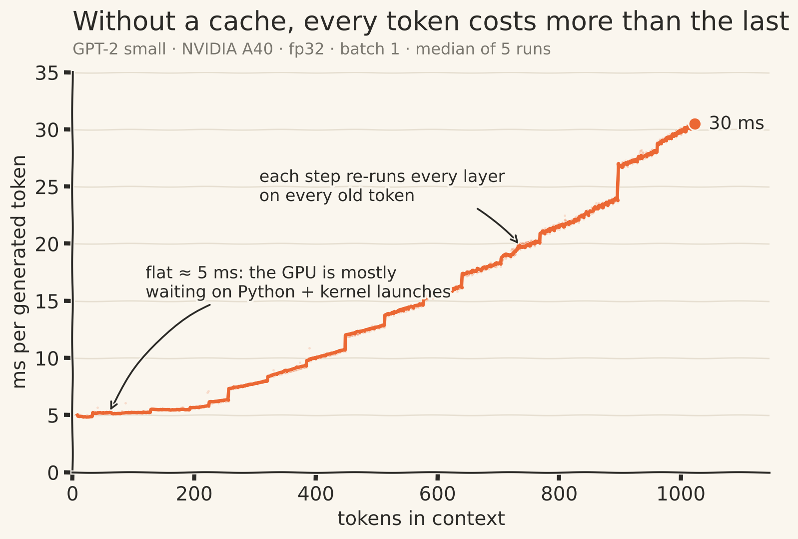
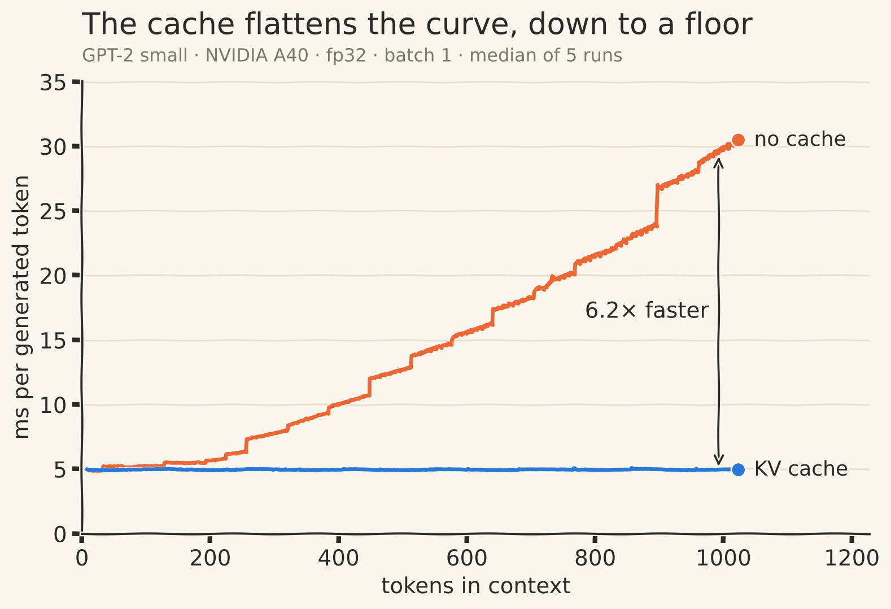
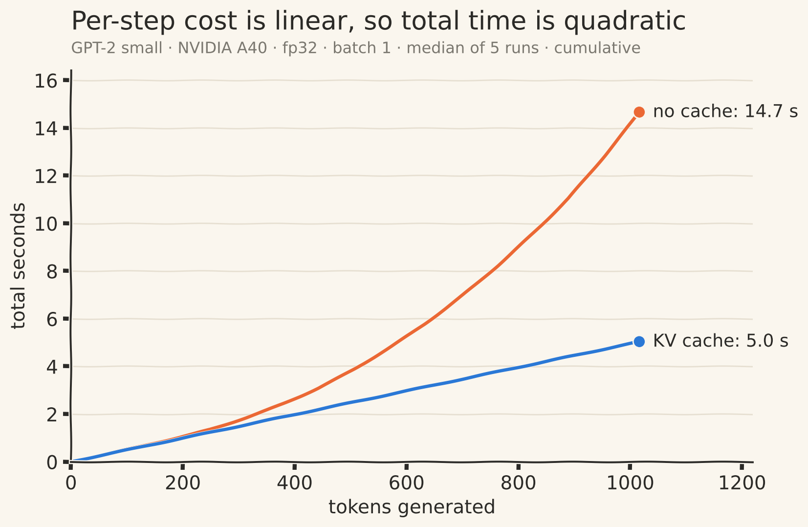
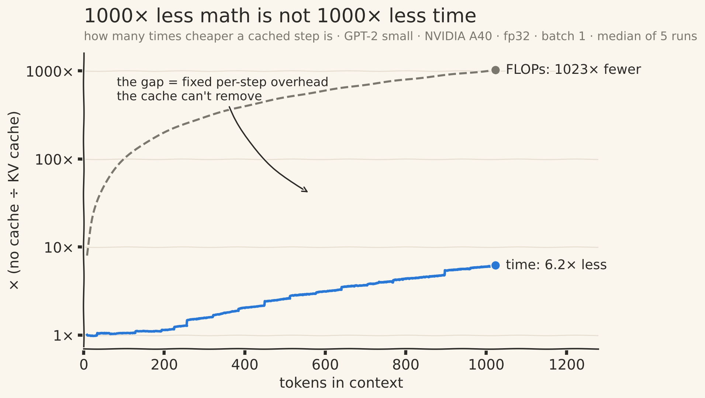
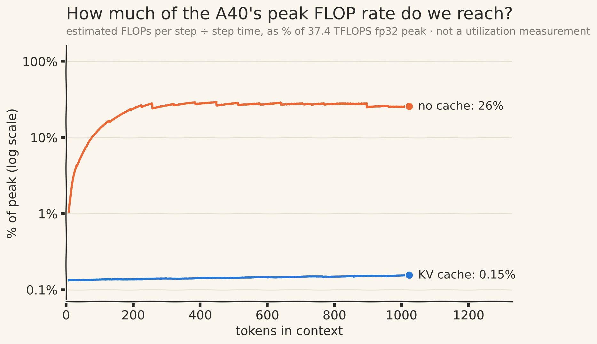
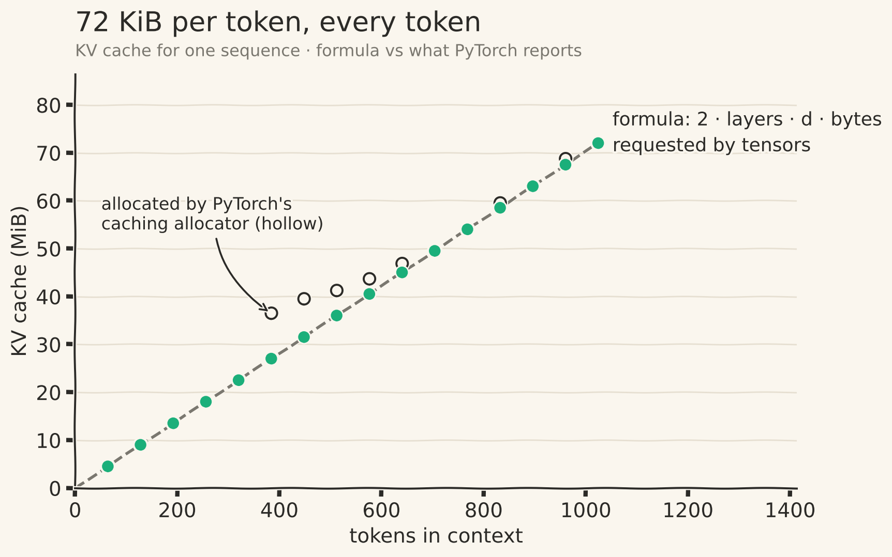

::: {.callout-note appearance="simple" icon=false}
## TL;DR

- I wrote GPT-2 small (124M) in PyTorch and loaded OpenAI's weights. My logits match Hugging Face's to within $6.1 \times 10^{-5}$, and cached and uncached generation produce identical tokens.
- At 1,000 tokens of context, the KV cache does **1,000× less arithmetic** per generated token. The token comes out only **6× faster**: 29.69 ms → 4.95 ms. Over a full 1,016-token generation: **14.66 s → 5.03 s (2.9×)**.
- The cached step takes 4.95 ms at *every* context length I tested. Its math would take about 8 µs at the GPU's peak rate. Something other than math sets the floor.
- The cache costs **72 KiB per token**. My causal masks quietly cost another **48 MiB**, two-thirds of a full cache, for nothing.
:::

## The question

I had imagined the KV cache as an intricate inference trick, some clever mechanism buried deep inside a serving engine. Then I implemented one. The idea is almost embarrassingly simple: compute something once, keep it, use it again. It's just storing things.

So how does something that ordinary make such a difference? And how *much* of a difference, exactly?

Every explanation I'd read stops at "the cache avoids recomputing past keys and values." That's true. It doesn't say how much faster generation gets, or why, or what's left once the cache is in. I wanted numbers. So I wrote GPT-2 small from scratch (about 150 lines of PyTorch), loaded the pretrained weights, built the cache myself, and timed every generated token from 8 tokens of context up to the model's 1,024-token limit.

I thought the cache would be the complicated part. It wasn't. The interesting complication was everything around it.

::: {.callout-tip appearance="simple" icon=false}
## Setup

GPT-2 small (124M), written from scratch, pretrained weights · NVIDIA A40 · fp32, TF32 off · batch size 1 · greedy decoding · prompt: *"Hello, I'm a language model,"* · every timing is bracketed by `torch.cuda.synchronize()`, after warmup, and reported as the **median of 5 runs** at each context length. These numbers describe this implementation on this hardware, not LLM inference in general.
:::

## Clue 1: the naive loop throws away almost everything it computes

A causal transformer is efficient to train because it handles a whole sequence in one forward pass. Every position produces a prediction for the token after it, so a sequence of length $T$ gives you $T$ training signals at once.

Generation turns that strength into waste. You only need the prediction at the *last* position:

```python
logits = model(idx)                          # (B, T, 50257): a prediction at every position
next_token = logits[:, -1, :].argmax(-1)     # keep the last one, throw away the rest
```

Step 500 runs all 12 layers over 500 tokens to produce one new token. Step 501 runs them over 501 tokens, and 500 of those it processed a moment ago. Nothing in the model forgets the earlier work. The program just has nowhere to keep it.

## Clue 2: the old keys and values can't change

Keeping old work only makes sense if that work can't go stale. I didn't want to assume it, so I proved it.

Let $h_j^{\ell}$ be the hidden state at position $j$ after layer $\ell$. **Claim:** $h_j^{\ell}$ depends only on tokens $0, \dots, j$.

- **Base case.** $h_j^{0} = \mathrm{wte}[x_j] + \mathrm{wpe}[j]$, which depends on token $j$ alone.
- **Inductive step.** Assume the claim at layer $\ell$. LayerNorm and the MLP act on each position independently, so they can't mix positions. Attention at $j$ reads only positions $m \le j$, because the causal mask forbids anything else. Each $h_m^{\ell}$ depends only on tokens $\le m \le j$. So $h_j^{\ell+1}$ depends only on tokens $0, \dots, j$. $\blacksquare$

Keys and values are linear projections of these states, $k_j^{\ell} = h_j^{\ell} W_K$ and $v_j^{\ell} = h_j^{\ell} W_V$. So **the K and V of token $j$, in every layer, are fixed the moment token $j$ is processed.** Recomputing them gives the same numbers, up to floating-point rounding.

That's what made the cache click for me. The optimization doesn't ask the model to compromise anything. It just stops a calculation whose answer is already known.

It also tells you exactly what to keep. Only attention reads other positions, and it reads them only through K and V. An old query is used once and never again. Old MLP outputs are fixed too, but nothing reads them again either. **A KV cache stores exactly what future steps will re-read, and nothing more.**

The proof also says when it breaks. Drop the causal mask (bidirectional attention, as in BERT) and future tokens leak into past positions. Add any layer that mixes positions *outside* attention, such as a normalization whose statistics span the sequence, and old states change when new tokens arrive. Either one breaks the cache.

## Clue 3: without a cache, a floor and then a line

{#fig-baseline}

@fig-baseline has two regimes. Up to about 200 tokens, each step costs a nearly constant **~5 ms**. After that, cost grows roughly linearly, to **~30 ms** at 1,024 tokens.

The linear part can be predicted on paper. A matmul against a weight matrix with $n$ parameters costs about $2n$ FLOPs per token. GPT-2's Linear layers hold $N \approx 123.5\text{M}$ weights, counting the output projection that shares its weights with the token embedding. Attention adds two $t \times t$ products per head. With $L = 12$ layers and width $d = 768$:

$$
\text{FLOPs}_{\text{no cache}}(t) \;\approx\; \underbrace{2Nt}_{\text{Linear layers}} \;+\; \underbrace{4Ld\,t^{2}}_{\text{attention}} \;\approx\; 247\text{M}\cdot t \;+\; 36{,}864\cdot t^{2}
$$

The two terms are equal at $t \approx 6{,}700$, far past GPT-2's 1,024-token limit. At $t = 1{,}000$, attention is about **13%** of the work. "Attention is quadratic" is the usual reason given for the cache, but it doesn't describe this loop. At this model size, **most of the waste is re-running the Linear layers on old tokens.**

This is also where two different quantities get mixed up. The cost **per step** is roughly linear in context. The **total** cost of generating $n$ tokens adds up those linear steps, so it grows quadratically.

Two more things in @fig-baseline need explaining:

- **The floor.** At $t = 10$ a step is about 2.5 GFLOPs, which the A40 can do in under 0.1 ms. The step takes 5 ms. Hold on to that; it comes back.
- **The staircase.** The line jumps at roughly 256, 448, 640, 768 and 896 tokens. My FLOP formula is smooth, so it can't produce steps. GPU matmul kernels work in fixed-size tiles, and the library can switch kernels at certain shapes, so crossing a boundary can add a whole tile of work at once. That's my hypothesis; I haven't tested it.

One easy saving falls out of the formula. The output projection ($768 \times 50{,}257$) runs on **every** position, even though generation uses one. That's about **27% of each step's FLOPs** spent predicting tokens I already have.^[The fraction is $\dfrac{2 \cdot 768 \cdot 50{,}257 \cdot (t-1)}{\text{FLOPs}_{\text{no cache}}(t)} \approx 27\%$ for any $t$ in this range. Slicing to the last position before the output projection removes it, with or without a cache.]

## Building the cache

The implementation is small. The mistakes are not.

In each attention layer: compute q, k and v for the **new** tokens only, append the new k and v *after* the cached ones, attend, and hand the updated cache back.

```python
def forward(self, x, past_kv=None):               # x: (B, T_new, C)
    q, k, v = self.c_attn(x).split(self.n_embd, dim=2)
    # reshape each to (B, n_head, T_new, head_dim)

    if past_kv is not None:
        past_k, past_v = past_kv
        k = torch.cat([past_k, k], dim=2)        # dim 2 is time: OLD first, then new
        v = torch.cat([past_v, v], dim=2)
    present = (k, v)

    T_total = k.size(2)
    T_past = T_total - T_new
    att = q @ k.transpose(-1, -2) / head_dim**0.5           # (B, nh, T_new, T_total)
    mask = self.mask[:, :, T_past:T_total, :T_total]
    att = att.masked_fill(mask == 0, float("-inf"))
    ...
    return self.c_proj(y), present
```

One mask slice covers both phases. During **prefill**, when the whole prompt goes in at once and $T_{\text{past}} = 0$, it's the ordinary causal triangle. During **decode**, one new token, it's a single row of ones: the new token may see everything before it, and itself.

The second change is easy to miss. Position embeddings must start where the cache ends:

```python
T_past = 0 if past_kvs is None else past_kvs[0][0].size(2)
pos = torch.arange(T_past, T_past + T, device=idx.device)   # not arange(T)
```

Generation becomes one prefill, then one token at a time:

```python
logits, kvs = model(prompt)                       # prefill: fills the cache
for _ in range(max_new_tokens):
    next_token = logits[:, -1, :].argmax(-1, keepdim=True)
    logits, kvs = model(next_token, kvs)          # decode: one token + cache
```

**Before trusting any timing, I checked correctness.** My logits match Hugging Face's GPT-2 to a maximum absolute difference of $6.1 \times 10^{-5}$, about ten float32 rounding steps at logit magnitudes near 100. Cached and uncached greedy generation produce identical tokens over 200 tokens. A fast cache that's subtly wrong is worse than no cache, and as the bugs below show, passing tests can still miss things.

## The prediction

With a cache, the Linear layers process one token instead of $t$, and attention compares one query against $t$ cached keys:

$$
\text{FLOPs}_{\text{cached}}(t) \;\approx\; 2N + 4Ld\,t
$$

Put that next to the uncached formula and it falls out in one line:

$$
\text{FLOPs}_{\text{no cache}}(t) \;\approx\; 2Nt + 4Ld\,t^{2} \;=\; t\cdot\big(2N + 4Ld\,t\big) \;=\; t \cdot \text{FLOPs}_{\text{cached}}(t)
$$

**An uncached step does exactly $t$ times the arithmetic of a cached step.** At $t = 1{,}000$ that's 1,000× less work for the same output. If time followed FLOPs, generation at long context would be a thousand times faster.

It isn't.

## The result: 6×, not 1,000×

{#fig-result}

| context $t$ | no cache | KV cache | measured speedup | FLOP reduction |
|---:|---:|---:|---:|---:|
| 10 | 4.89 ms | 4.94 ms | 1.0× | 10× |
| 100 | 5.20 ms | 4.95 ms | 1.1× | 100× |
| 500 | 12.70 ms | 4.95 ms | 2.6× | 500× |
| 1,000 | 29.69 ms | 4.95 ms | **6.0×** | **1,000×** |

: Per-token latency, median of 5 runs. {#tbl-speed}

The cached step costs **4.95 ms at every context length**. Not slowly rising, not roughly flat: the same, within noise, from 10 tokens to 1,000. At short context the cache buys nothing, because both versions sit on the same floor.

{#fig-total}

End to end, generating 1,016 tokens takes **14.66 s** without the cache and **5.03 s** with it, a **2.9×** speedup (@fig-total). That's the number a user actually feels. It's smaller than the per-token 6× because most steps happen at shorter contexts, where the two versions are closer.

## Chasing the missing 167×

{#fig-gap}

At 1,000 tokens: 1,000× less math, 6× less time. The ratio between those is about 167. That isn't a measurement of anything. It's the size of the thing I have to explain.

First question: how much arithmetic does each step get done per second? Estimated FLOPs per step, divided by measured step time, compared with the A40's 37.4 TFLOPS fp32 peak:

{#fig-throughput}

| context $t$ | no cache | % of peak | KV cache | % of peak |
|---:|---:|---:|---:|---:|
| 10 | 0.51 TFLOPS | 1.4% | 0.050 TFLOPS | 0.13% |
| 100 | 4.82 TFLOPS | 12.9% | 0.051 TFLOPS | 0.14% |
| 500 | 10.46 TFLOPS | 28.0% | 0.054 TFLOPS | 0.14% |
| 1,000 | 9.56 TFLOPS | 25.6% | 0.057 TFLOPS | 0.15% |

: Achieved arithmetic throughput. {#tbl-throughput}

A cached step at $t = 1{,}000$ is about 0.28 GFLOPs. At peak rate, that's roughly **8 µs** of arithmetic, inside a step that takes **4,950 µs**.

That doesn't prove the GPU is idle 99.8% of the time. Peak FLOPS is a ceiling no real kernel reaches, and small kernels can be limited by memory traffic before they're limited by arithmetic. What it does prove is that arithmetic can't explain this step's cost. Something else is setting it.

My leading suspect is fixed per-step overhead. Each step, Python walks the forward pass and launches dozens of small GPU kernels per layer, one after another, each too small to keep the GPU busy. The evidence that fits:

- The cached step's time **doesn't change with context**, even though its attention work grows 100× from $t = 10$ to $t = 1{,}000$.
- The uncached loop sits on the **same ~5 ms floor** at short context, where it also does little math.

What I don't have yet is a profiler trace that pins it down. Until then, overhead is the leading suspect, not a confirmed cause. The test is to remove it: CUDA graphs capture a whole step and replay it with a single launch. If the floor drops, the suspect is confirmed.

## Two bugs that taught me how to test

### The cache in the wrong order, and a test that passed anyway

My first version did `torch.cat([k, past_k])`, new key first. In hindsight it's plainly wrong. My single-token test compared cached against uncached outputs, and it passed with a maximum difference of $9 \times 10^{-8}$.

It passed because of how attention works. During single-token decode, the new query may see every key, so the mask row is all ones and masks nothing. Attention is then a weighted average over a *set* of (key, value) pairs:

$$
\text{out} = \sum_j \operatorname{softmax}_j\!\left(\frac{q \cdot k_j}{\sqrt{d_h}}\right) v_j
$$

Reorder the keys and values *together*, and every weight still multiplies its own value. The sum doesn't change. **Attention doesn't care about the order of keys. Only the mask does.** Position isn't lost either, because it was added to the input before $k$ was computed. Each key carries its position inside its numbers.

The bug shows up as soon as two new tokens go in at once with a cache, which is what speculative decoding does. The mask then assumes old keys come first, hides the wrong columns, and a token can see its own future. Anything that treats cache index as time breaks the same way, including sliding-window eviction and a preallocated cache. A two-token test caught it immediately.

That changed how I think about tests. "It passed" isn't enough. The real question is: **what kind of error could this test even catch?**

### Wrong positions: no crash, just nonsense

If decode uses `arange(T)` instead of `arange(T_past, T_past + T)`, every new token is embedded as if it were at position 0. The shapes all work and the forward pass runs. Here's what comes out:

```text
correct:  Hello, I'm a language model, not a programming language. I'm a language model. ...
wrong:    Hello, I'm a language model, not,,,,,,,,,,,,,,,,,,,,,,,,,,,,,,,,,,,,,,,,,,,,,,,,,
```

The first new token is right, because it came from prefill, before the bug could matter. Then generation collapses. There's something humbling about a bug that is completely legal tensor algebra and completely wrong modelling. A shape mismatch crashes. A wrong *value* in the right shape never does. That's why the cached-vs-uncached equality check runs before any timing.

## Memory: 72 KiB per token, every token

Per token, the cache holds one key and one value vector per layer:

$$
\text{bytes per token} \;=\; \underbrace{2}_{K,\,V} \times \underbrace{12}_{L} \times \underbrace{768}_{d} \times \underbrace{4}_{\text{fp32}} \;=\; 73{,}728\ \text{B} \;=\; 72\ \text{KiB}
$$

Measuring that turned into its own small investigation. My first measurement subtracted the memory in use before generation from the memory in use after. Both numbers PyTorch offers came out **above** the formula, at every context length:

| tokens | formula | requested by tensors | allocated |
|---:|---:|---:|---:|
| 64 | 4.5 MiB | 12.6 MiB | 12.6 MiB |
| 384 | 27.0 MiB | 35.1 MiB | 44.6 MiB |
| 1,024 | 72.0 MiB | 80.1 MiB | 80.1 MiB |

: First attempt. Two different discrepancies. {#tbl-mem-first}

There are two discrepancies here, and they behave differently.

**Clue A: a constant offset.** The bytes the tensors requested sit exactly 8,519,688 bytes above the formula at *every* point, from 64 tokens to 1,024. A constant doesn't grow per token, so it isn't cache. It's something allocated once, after my baseline was taken. And 8,519,680 is a recognizable number: $2 \times 4\,\text{MiB} + 8 \times 16\,\text{KiB}$, the default size of the cuBLAS workspace PyTorch uses on this GPU. PyTorch allocates it lazily, through its own allocator, on the first matrix multiply. My baseline was taken before the model had run a single matmul, so the workspace landed inside my measurement. The last 8 bytes are the one-element `int64` tensor holding the next token.

The fix is one warmup forward pass before taking the baseline. With that:

{#fig-memory}

**Clue B: a bump.** With the workspace accounted for, the requested bytes land on the formula line (@fig-memory). What's left is the hump in `torch.cuda.memory_allocated()` between ~384 and ~640 tokens, peaking at ~9.5 MiB above what was requested and returning to the line at 704 tokens. Smaller allocator bumps also appear at 832 and 960 tokens. That's PyTorch's caching allocator handing out reusable blocks that can be larger than the request. It's real memory the process holds, but it isn't cache payload.

The lesson is the same one the bugs taught me, from another angle: a measurement is only as good as its baseline. Subtract "before" from "after," and you measure everything that happened in between, not only the thing you meant to measure.

At batch size 1, 72 MiB is small next to the model's **475 MiB** of fp32 weights. But the cache grows with batch × context, and the weights don't. The cache overtakes the weights at about **6,750 tokens of batch × context**, roughly seven full-length sequences. Sixty-four full-context requests need **4.5 GiB** of cache, for a 124M model. That's why serving systems put so much work into KV memory: paged allocation, lower-precision caches, and architectures with fewer KV heads.

And then there's a cost I inflicted on myself. My implementation registers a $1024 \times 1024$ fp32 causal mask in **every** layer. Twelve copies take **48 MiB**, two-thirds of a full-length cache, to store twelve identical triangles of ones. A single shared mask, a `bool` mask (4× smaller), or no stored mask at all (letting a fused attention kernel apply causality) fixes it. I came in thinking the cache was the complicated optimization. I left having found that my most ordinary buffers were expensive too.

## What I haven't verified yet

::: {.callout-warning appearance="simple" icon=false}
Everything above is measured, except these three:

1. **The floor's cause.** "Python plus kernel-launch overhead" is inferred from @tbl-throughput and the flat cached curve. It hasn't been profiled.
2. **The staircase in @fig-baseline.** Tile quantization or kernel switching is a hypothesis. Timing a single matmul across the same sizes would test it.
3. **Scope.** A 124M model at batch size 1 is the worst case for overhead. A bigger model or batch puts more math behind each kernel launch, and the measured speedup should move toward the FLOP ratio. The 6× here is not a universal number.
:::

## What I'd tell myself before starting

1. **Verify before measuring.** Match a reference implementation, then prove cached output equals uncached output, on both single-token *and* multi-token paths.
2. **The cache is mathematically exact.** Under causal attention, old K and V are determined once their token is processed. Storing them changes nothing about what the model computes.
3. **FLOP ratios are not speedups.** 1,000× less math became 6× per token and 2.9× end to end. Divide your FLOPs by your time; it tells you which regime you're in.
4. **At this scale, the waste is the Linear layers, not attention.** The $t^2$ term is 13% of the work at 1,000 tokens.
5. **Wrong values in correct shapes don't crash.** Cache order, positions, mask slices and redundant buffers all fail silently.
6. **Don't promote a plausible explanation to a fact** until you've run the experiment that could prove it wrong.

## Next: the 5 ms floor

This experiment didn't end with a tidy answer. It ended with a suspect. In the next post I'll profile a decode step, capture it with CUDA graphs and `torch.compile`, replace `torch.cat` with a preallocated cache, and apply the output projection to the last position only. If the floor drops, the overhead story holds. If it doesn't, I'll have learned something better than a neat explanation that happened to sound right.

For now, here's what stays with me. A transformer trains efficiently by processing every position at once, and the same design makes naive generation wasteful. The causal math gives us permission to keep exactly what we need. The measurements show that permission to do less math is not a promise to finish proportionally sooner.

The surprising part wasn't that caching works. It was how much it saves, and then how much time is still left.

::: {.callout-note appearance="simple" icon=false}
## Reproduce it

All numbers and figures come from one script run against the from-scratch model, both in this site's repository under [`code/kv-cache`](https://github.com/angry-kratos/angry-kratos.github.io/tree/main/code/kv-cache): `python kv_experiments.py` runs every experiment and writes the raw data to `results/results.json`, and `--plots-only` redraws the figures from it.
:::
