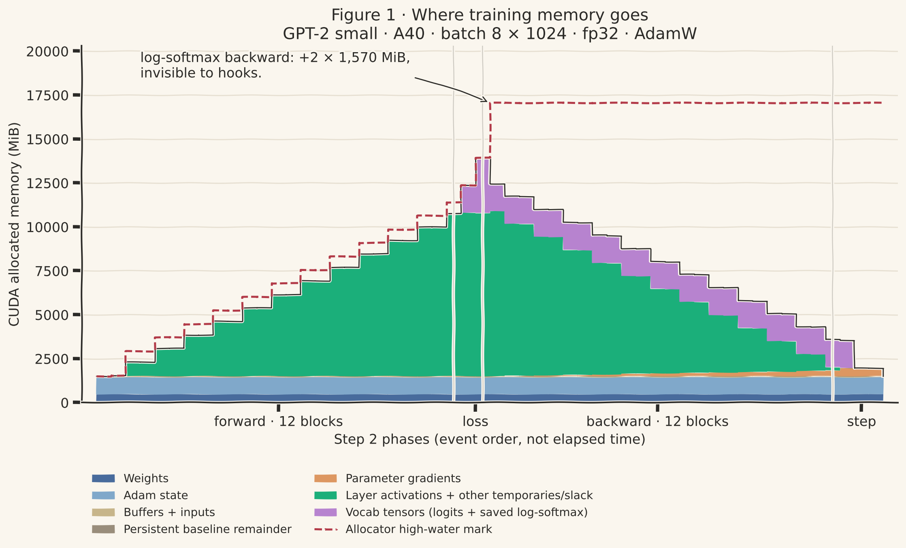
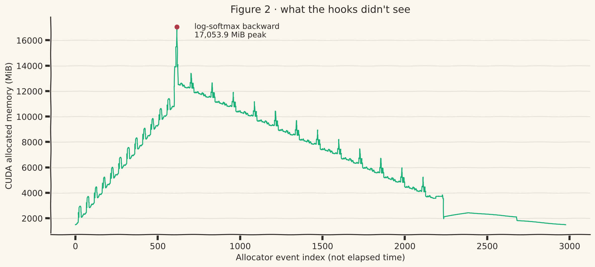
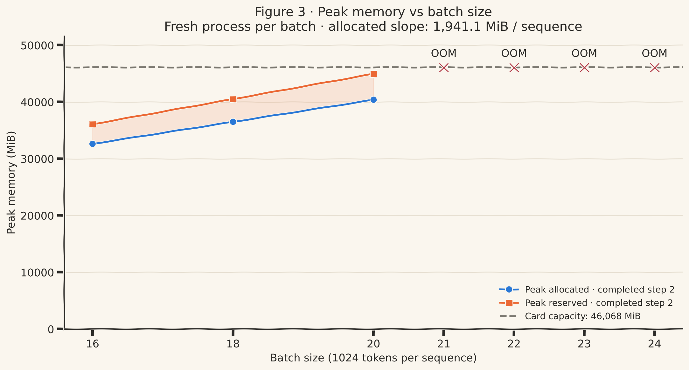

::: {.callout-note appearance="simple"}
## The short version

- Training GPT-2 small (124M parameters) in fp32 with Adam needs a **16-byte-per-parameter budget** for weights, gradients and Adam state once all three exist. That's 1.9 GB.
- Feed it 8 sequences of 1,024 tokens and the peak hits **17,054 MiB**. The model and optimizer are only **9%** of that.
- **54%** is *activations*: things each layer saves during the forward pass so that the backward pass can compute gradients.
- **37%** is four tensors, each the size of the vocabulary times every token in the batch, that exist for a split second inside the loss function.
- The straight-line math said a 48 GB A40 fits a batch of 22. The real answer is **20**, in this run. Peak reserved memory was about 11% above peak allocated memory; that ratio is an observation, not a universal rule.
:::

## The question

In my [last post](/posts/2026-10-kv-cache/) I built GPT-2 from scratch and made text generation 6× faster with a KV cache. That was *inference*: running a trained model. This post is about *training*: teaching a model, one step at a time.

Everyone says training needs much more memory than inference. I wanted to know exactly how much more, and where every byte goes. Not "roughly", but a ledger I could check line by line against the GPU.

The setup is the same as before:

| | |
|---|---|
| Model | GPT-2 small, written from scratch, 124,439,808 parameters |
| GPU | one NVIDIA A40, 48 GB (46,068 MiB as `nvidia-smi` reports it) |
| Precision | fp32 (4 bytes per number), TF32 off |
| Optimizer | AdamW |
| Batch | 8 sequences × 1,024 tokens = 8,192 tokens per step |
| Data | random tokens. Memory doesn't care what the tokens say. |

::: {.callout-tip collapse="true"}
## MiB vs MB, and why I use MiB

1 MB is 1,000,000 bytes. 1 MiB is 2²⁰ = 1,048,576 bytes. PyTorch and `nvidia-smi` both count in MiB, so every number here is in MiB, which keeps my numbers matching what the tools print.
:::

## My guesses, before running anything

I wrote these down before writing any code. I was wrong in interesting ways, so here they are, unedited:

1. **Weights, gradients and optimizer:** weights ≈ 473 MB, gradients about the same, and Adam maybe 1/5 of that (~100 MB), "since it attaches to the MLPs".
2. **Largest batch that fits:** "huge". The model is only ~1.5 GB and the card has 46 GB free.
3. **When memory peaks:** during the backward pass, because that's when gradients, weights and optimizer state all exist.
4. **Largest single tensor:** the token embedding, since it has the most weights.

::: {.callout-warning appearance="simple"}
## Make your own guess

Before you scroll: how much GPU memory does one training step of a 124M-parameter model need, at 8 × 1,024 tokens? Write a number down. You'll find out in a minute how close you were.
:::

## Part 1: what the model owns, 16 bytes per parameter

Some memory exists no matter how much data you train on. It belongs to the model itself.

**Weights.** These are the numbers the model learns. 124,439,808 of them × 4 bytes = **474.7 MiB**.

One detail I had to check: GPT-2 uses the *same* matrix for the token embedding at the input and for scoring words at the output (`lm_head`). The two are *tied*. If you count both, you get 163M parameters and overstate everything by 30%. I verified in code that they share one piece of memory:

```python
model.lm_head.weight.data_ptr() == model.transformer.wte.weight.data_ptr()   # True
```

**Gradients.** For every weight, backpropagation computes one number: which direction to nudge that weight, and how hard. One gradient per weight, same size: **474.7 MiB**.

**Adam's state.** This is where my guess was furthest off. Adam doesn't just follow the gradient. For *every single weight* it keeps two running averages:

- `m`: the average of recent gradients. Think momentum: keep moving the way you've been moving.
- `v`: the average of recent *squared* gradients. This gives each weight its own step size, so weights with noisy gradients take smaller steps.

Two extra numbers per weight: **949.4 MiB**. That's not 1/5 of the model; it's 2× the model. And it isn't attached to the MLPs; it covers every parameter.

| What | Bytes per parameter | MiB |
|---|---|---|
| Weights | 4 | 474.7 |
| Gradients | 4 | 474.7 |
| Adam `m` | 4 | 474.7 |
| Adam `v` | 4 | 474.7 |
| **Total** | **16** | **1,898.8** |

So that's the rule: **training in fp32 with Adam costs 16 bytes per parameter.** A 7B model would need 112 GB for this part alone, before a single token.

### Checking it against the GPU

I trained for two steps and read `torch.cuda.memory_allocated()` after every line. Everything matched the arithmetic:

| After | Change | Why |
|---|---|---|
| a warm-up matmul | +8.1 MiB | cuBLAS (the matrix-multiply library) reserves a scratch pad. Same 8 MiB as in post 1. |
| `model.cuda()` | +527.2 MiB | 474.7 weights + 48 MiB of causal masks + rounding |
| creating the optimizer | **+0** | Adam is lazy: `m` and `v` don't exist until the first `step()` |
| first `optimizer.step()` | +950.7 MiB | here they are |
| `zero_grad(set_to_none=True)` | −475.6 MiB | gradients freed |
| second `optimizer.step()` | **+0** | `m` and `v` already exist and are updated in place |

That last row matters if you ever measure memory yourself: **step 1 is not representative.** Adam's 949 MiB appears partway through step 1, so step 1's measured peak was 959 MiB lower than step 2's. All the numbers below are from step 2.

One sanity check on the training loop itself: an untrained model should be equally unsure about all 50,257 words, and the loss of a uniform guess is ln(50,257) = 10.82. My first loss was 10.98. That is a useful sanity check, though it does not by itself prove the loop is correct.

## Part 2: what training saves, activations

Here's the number that broke my mental model. At the start of step 2, the GPU holds 1,494 MiB. After the forward pass it holds **13,913 MiB**. The forward pass added 12,419 MiB, more than 8× everything the model and optimizer own.

To understand why, look at the simplest possible layer, a matrix multiply:

$$y = x \cdot W$$

To train $W$, backpropagation needs the gradient of the loss with respect to $W$, and calculus says it's:

$$\frac{\partial L}{\partial W} = x^\top \cdot \frac{\partial L}{\partial y}$$

That formula contains **$x$, the layer's input from the forward pass.** By the time backward reaches this layer, the forward pass has long moved on. So the layer *has to keep* $x$ in memory until then.

```{=html}
<div class="tm-widget" style="padding:10px 12px">
<svg viewBox="0 0 680 190" width="100%" role="img" aria-label="Forward pass saves the input x; backward pass uses saved x to compute the weight gradient">
  <text x="20" y="30" font-size="13" fill="#7a776f">forward →</text>
  <rect x="90" y="42" width="90" height="40" rx="6" fill="#efe8da" stroke="#c9bfab"/><text x="135" y="67" font-size="15" text-anchor="middle" fill="#2b2a27">x</text>
  <line x1="182" y1="62" x2="268" y2="62" stroke="#2b2a27" stroke-width="1.5" marker-end="url(#tma)"/>
  <rect x="272" y="42" width="110" height="40" rx="6" fill="#486b9c"/><text x="327" y="67" font-size="15" text-anchor="middle" fill="#fff">× W</text>
  <line x1="384" y1="62" x2="470" y2="62" stroke="#2b2a27" stroke-width="1.5" marker-end="url(#tma)"/>
  <rect x="474" y="42" width="90" height="40" rx="6" fill="#efe8da" stroke="#c9bfab"/><text x="519" y="67" font-size="15" text-anchor="middle" fill="#2b2a27">y</text>
  <path d="M135 84 L135 128" stroke="#1baf7a" stroke-width="2" fill="none" stroke-dasharray="5 4" marker-end="url(#tmg)"/>
  <rect x="80" y="132" width="110" height="36" rx="6" fill="#1baf7a"/><text x="135" y="155" font-size="13" text-anchor="middle" fill="#fff">x, saved</text>
  <text x="20" y="182" font-size="13" fill="#7a776f">← backward</text>
  <rect x="474" y="132" width="90" height="36" rx="6" fill="#efe8da" stroke="#c9bfab"/><text x="519" y="155" font-size="14" text-anchor="middle" fill="#2b2a27">dL/dy</text>
  <line x1="472" y1="150" x2="410" y2="150" stroke="#2b2a27" stroke-width="1.5" marker-end="url(#tma)"/>
  <line x1="192" y1="150" x2="246" y2="150" stroke="#1baf7a" stroke-width="1.5" marker-end="url(#tmg)"/>
  <rect x="250" y="132" width="155" height="36" rx="6" fill="#dd9761"/><text x="327" y="155" font-size="13" text-anchor="middle" fill="#fff">dL/dW = xᵀ·dL/dy</text>
  <defs><marker id="tma" viewBox="0 0 10 10" refX="8" refY="5" markerWidth="7" markerHeight="7" orient="auto"><path d="M1 1L8 5L1 9" fill="none" stroke="#2b2a27" stroke-width="1.5"/></marker>
  <marker id="tmg" viewBox="0 0 10 10" refX="8" refY="5" markerWidth="7" markerHeight="7" orient="auto"><path d="M1 1L8 5L1 9" fill="none" stroke="#1baf7a" stroke-width="1.5"/></marker></defs>
</svg>
</div>
```

These saved tensors are called **activations**. Every layer saves the ones it will need, and **the saved values must remain available until backward uses them.** They pile up across the whole forward pass.

The crucial difference from Part 1: the model's memory is fixed, but activations are saved *for every token of every sequence*. Double the batch and you double them.

### Inside one block: 769 MiB

I added memory readings before and after every transformer block. Each of the 12 blocks adds exactly **769.1 MiB**, the same every time. Here's what each block saves, worked out from my code at 8 × 1,024 tokens:

| Saved tensor | Shape | MiB |
|---|---|---|
| LayerNorm 1 input and output | 2 × (8, 1024, 768) | 48 |
| `c_x`: the combined query, key and value | (8, 1024, 2304) | 72 |
| **Attention probabilities (softmax output)** | **(8, 12 heads, 1024, 1024)** | **384** |
| Causal mask comparison (bool) | (1024, 1024) | 1 |
| Attention output, before projection | (8, 1024, 768) | 24 |
| LayerNorm 2 input and output | 2 × (8, 1024, 768) | 48 |
| MLP hidden layer, before and after GELU | 2 × (8, 1024, 3072) | 192 |
| **Total per block** | | **769** |

Half of every block is one tensor: the attention probabilities. For every head, every token holds a score for every other token, 1,024 × 1,024 numbers. Everything else grows in proportion to the sequence length; this one grows with its **square**. Double the context and the rest of the block doubles, but this tensor quadruples. (Keeping that matrix from ever being stored is exactly what FlashAttention does, which is a later post.)

12 blocks × 769 MiB = 9,229 MiB, plus 48 MiB for the embedding output and the final LayerNorm: **9,276 MiB predicted, 9,278 measured.**

### Watch it happen

This is every reading I took during step 2, 55 hook points plus the true peak from the allocator trace. Press play, or drag the slider:

```{=html}
<div class="tm-widget"><div id="tm-scrubber"></div></div>
<script src="widgets/step-scrubber.js"></script>
```

The shape is a mountain: forward stacks one 769 MiB block per layer, backward takes them off from the top. Gradients (orange) build up as backward passes each layer, and the peak sits right where forward turns into backward.

## Part 3: the peak, four tensors the size of the vocabulary

The tallest part of the mountain isn't a layer at all. It's the end of the model, where it turns its 768-number summary of each token into a score for every word in the vocabulary.

That output is the **logits**: one score per word, per position:

$$8 \times 1{,}024 \times 50{,}257 \times 4 \text{ bytes} = 1{,}570.5 \text{ MiB}$$

That's one tensor, bigger than the whole model and Adam combined. My guess #4 said the embedding is the largest thing, but the embedding is a *weight* (147 MiB). The logits are a computed result, and with a 50,257-word vocabulary they dwarf everything else.

Then cross-entropy makes it worse. It computes a log-softmax over those scores and *saves* the result for backward: another 1,570.5 MiB. And the very first thing backward does is compute the gradient through that log-softmax, which allocates **two more** tensors of exactly the same size while everything else is still alive.

At the peak there are four vocab-sized tensors at once: 4 × 1,570.5 = **6,282 MiB**.

{#fig-step fig-alt="Stacked area chart of GPU memory through step 2 of GPT-2 training. A flat base of weights and Adam state around 1,500 MiB; green activations climb in 12 steps during forward to about 10,800 MiB; purple vocab tensors push it to 13,900 MiB at the loss; the dashed high-water line jumps to 17,054 MiB just after the loss; then memory steps down through backward to about 2,000 MiB."}

So here's where all 17,054 MiB go at the peak:

| At the peak | MiB | Share |
|---|---|---|
| Weights + Adam + masks + library workspaces | 1,494 | **9%** |
| Saved activations from the 12 blocks (+ embedding, final LayerNorm) | 9,278 | **54%** |
| Four vocab-sized tensors in cross-entropy | 6,282 | **37%** |
| **Total** | **17,054** | |

The part I expected to matter (the model) is less than a tenth. More than a third goes to the loss function's handling of a 50,257-word vocabulary. That's why libraries like Liger Kernel ship a *fused* linear + cross-entropy that never creates the full logits tensor at all.

### My hooks missed it by 3 GB

My hook readings topped out at **13,913 MiB**. The real peak was **17,054 MiB**. The two extra tensors live and die *inside* cross-entropy's backward, between two of my readings, so the hooks never saw them.

To find the peak I used PyTorch's memory recorder, `torch.cuda.memory._record_memory_history()`, which logs every single allocation and free. The trace shows exactly what my hooks skipped:

{#fig-trace fig-alt="Line chart of allocated memory across about 3,000 allocator events during step 2. Memory climbs in a sawtooth staircase to about 11,000 MiB, spikes sharply to 17,054 MiB, labelled log-softmax backward, then descends in a sawtooth through backward, finishing near 1,500 MiB."}

The green bucket is a residual: mainly saved layer activations, plus other temporaries and allocator slack. The purple bucket uses exact tensor shapes and known lifetimes; it is a ledger decomposition rather than a separate allocation counter.

The recorder also tells you *who* asked for the memory. The allocation that set the peak is 1,646,821,376 bytes (exactly one logits-sized tensor), requested by `LogSoftmaxBackward0`.

**The lesson for measuring:** sampling at layer boundaries tells you the shape, but not the peak. Use `torch.cuda.max_memory_allocated()` or the allocator trace.

::: {.callout-tip collapse="true"}
## Go deeper: small details and open questions

Once you account for memory byte by byte, small numbers stop being noise. Each of these had an explanation:

- **Two 8 MiB allocations, not one.** The final audit found two persistent allocations of 8,519,680 bytes outside the tensor ledger, consistent with cuBLAS workspaces. They predate the recorded history, so their allocation stacks are unavailable; the snapshot alone does not prove which thread or library created each one.
- **The embedding's gradient arrives last.** During backward, gradients grow by exactly 27.04 MiB per block (7,087,872 parameters × 4 bytes), then jump by 150 MiB at the very end. Because the embedding is tied to `lm_head`, autograd holds `lm_head`'s half of the gradient in a buffer for the *entire* backward pass and only adds it to `.grad` once the embedding's half arrives.
- **51 MiB before block 1 starts.** That's the token embeddings (24), position embeddings (3), and their sum (24). Two of those are local variables in `forward()`, so they stay alive until `forward()` returns.
- **The last ~6 MiB.** The final snapshot has about 5.8 MiB more allocated block space than requested payload. This is allocator slack, which can include rounding and oversized reused blocks; I have not attributed every byte to a particular allocator decision.
- **Still open:** inside each forward block, the trace shows a short spike of about 625 MiB. My best guess is that `score` and `masked_score` are local variables in my attention code, so three 384 MiB tensors are alive at once until the function returns. It doesn't move the peak, so I've parked it.
:::

## Part 4: how big a batch actually fits?

With the ledger in hand, the batch-size question becomes arithmetic. Every extra sequence adds its own activations and its share of the vocab tensors:

$$\frac{17{,}054 - 1{,}494}{8} \approx 1{,}945 \text{ MiB per sequence}$$

The A40 had 45,440 MiB free when I started, so:

$$\frac{45{,}440 - 1{,}494}{1{,}945} = 22.6 \quad\Rightarrow\quad \text{batch } 22$$

I tested it, running each batch size in a **fresh process**: after an out-of-memory crash, leftover memory can make the next attempt fail unfairly.

{#fig-batch fig-alt="Line chart of peak memory against batch size. Allocated rises from 32,611 MiB at batch 16 to 40,375 at batch 20; reserved rises from 36,072 to 44,948, just under the 46,068 MiB capacity line. Batches 21 to 24 are marked OOM."}

| Batch | Result | Peak allocated | Peak reserved |
|---|---|---|---|
| 16 | ✅ | 32,611 | 36,072 |
| 18 | ✅ | 36,489 | 40,504 |
| 20 | ✅ | 40,375 | 44,948 |
| 21 | ❌ out of memory in step 2 | | |
| 22–24 | ❌ out of memory | | |

The slope was spot on: **1,941 MiB per sequence**, against 1,945 predicted. But the answer is **20**, not 22. Two sequences went missing.

### Where the two sequences went: allocated vs reserved

`memory_allocated()` counts active allocations tracked by PyTorch's allocator, including allocator-managed workspaces and rounding. But PyTorch doesn't hand memory back to the GPU every time a tensor dies, because asking the GPU for memory is slow. It keeps freed blocks in its own pool and reuses them. That's the *caching allocator*, and the pool's size is `memory_reserved()`.

The pool can't always reuse what it has. A request for 1,571 MiB won't fit into two free 800 MiB blocks, even though 1,600 MiB is technically free. So the pool grows past what's strictly alive. At batch 20, reserved peaked at **44,948 MiB**, about 11% above peak allocated and just 492 MiB below the initially free memory. These are separate high-water marks, so their difference is not an instantaneous fragmentation measurement. Extending the observed ratio to batch 21 predicts roughly 47,000 MiB reserved, above that budget. Batch 21 did fail, but the ratio is a heuristic, not proof of the exact allocation failure mechanism.

**An allocation can fail before active tensor bytes reach the card's capacity.** The allocator needs a suitably sized block or room to obtain one. The straight-line tensor budget alone did not predict the largest working batch.

### Try it yourself

This calculator uses the formula from my measurements: the 1,494 MiB fixed part, 769 MiB per block per 8 sequences (split into the part that grows with sequence length and the part that grows with its square), and the four vocab tensors. It reproduces all four of my measured peaks to within 13 MiB (under 0.04%). Reserved is estimated using the roughly 11% gap between the measured peaks. Fit verdicts are estimates; allocator behavior can change with batch size and sequence length.

```{=html}
<div class="tm-widget">
<div class="tm-legend">
<span><i style="background:#80a8ca"></i>model + Adam</span><span><i style="background:#1baf7a"></i>layer activations</span>
<span><i style="background:#0f7a54"></i>attention probabilities (T²)</span><span><i style="background:#b783cf"></i>vocab-sized tensors</span>
<span><i style="border:1px dashed #7a776f;background:transparent"></i>allocator pool overhead</span>
</div>
<div id="tm-fit"></div>
</div>
<script src="widgets/fit-calculator.js"></script>
```

Try halving the sequence length to 512. The batch that fits more than doubles, because the attention probabilities shrink to a quarter.

## Scoring my guesses

| I guessed | What actually happened |
|---|---|
| Adam ≈ 100 MB, attached to the MLPs | 949 MiB: two numbers for *every* weight |
| Max batch "huge", since the model is only ~1.5 GB | 20. Each sequence costs ~1.9 GB, more than the whole model. |
| Peak during backward | ✅ Right, but not for my reason: it's the start of backward, inside the loss, when all activations are still alive |
| Largest tensor = the embedding | The embedding is a weight (147 MiB). The largest are the logits (1,571 MiB), and there are four of them at the peak. |

The pattern in my mistakes: I kept counting what the model *owns* and forgetting what training *makes*. That second part is 91% of the peak.

::: {.callout-tip collapse="true"}
## Bugs I hit along the way

I'm learning PyTorch from the ground up, and these cost me time. Maybe they'll save you some.

- **Slicing the wrong dimension.** For inputs and targets shifted by one token, I wrote `buffer[:T]` and `buffer[1:]`. With one index, PyTorch slices dimension 0: the *batch*, not the tokens. The fix is `buffer[:, :-1]` and `buffer[:, 1:]`. Print shapes after every slice.
- **`.view` vs `.reshape`.** `y = buffer[:, 1:]` skips one token per row, so its numbers aren't one continuous block of memory. `.view(-1)` can't flatten that and crashes. `.reshape(-1)` copies when it has to.
- **Initializing before building.** I put `self.apply(self._init_weights)` at the top of `__init__`, before any layers existed, so it initialized nothing. Order matters in a constructor.
- **A view keeps its whole parent alive.** My KV-cache model returned `k` and `v`, which are views of the bigger `c_x` tensor. Holding them pinned all of `c_x`: 864 MiB of invisible leak at this batch size. The training copy doesn't return a cache at all.
- **A Python variable is a reference.** After `loss.backward()`, my variable `logits` still pointed at 1,571 MiB. `del logits` freed it in one line.
:::

## What's next

This post was about *where* memory goes. The next one is about getting it back: mixed precision (bf16), gradient checkpointing (recompute activations instead of saving them), gradient accumulation, and a fused cross-entropy, measured against today's baseline of **batch 20**.

After that comes another post in my series: *why 3 GPUs isn't 3× faster.*

## Reproduce it

All code and raw results are in [`code/training-memory/`](https://github.com/angry-kratos/angry-kratos.github.io/tree/main/code/training-memory). The [batch-sweep CSV](https://github.com/angry-kratos/angry-kratos.github.io/blob/main/code/training-memory/results/batch_sweep/batch_sweep.csv) includes partial OOM observations, marked separately from completed runs. PyTorch 2.5.1, CUDA 12.1, one A40.

| File | What it does |
|---|---|
| `model.py` | GPT-2 from scratch, training version (no KV cache, returns a loss) |
| `train_memory_original.py` | the first experiment: memory after every line of two training steps |
| `profile_step2.py` | hooks on every block + allocator trace for step 2 |
| `train_memory.py`, `batch_sweep.py` | one fresh process per batch size |
| `plot_step2.py`, `plot_batch_sweep.py` | the figures |
